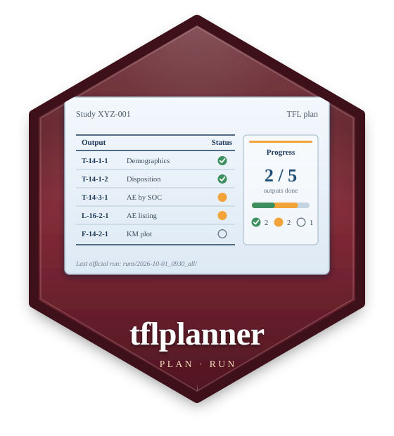

<!-- README.md is written by hand; keep it short and link to the pkgdown site. -->

# tflplanner 

<!-- badges: start -->
[](https://github.com/ichirio/tflplanner/actions/workflows/R-CMD-check.yaml)
[](https://github.com/ichirio/tflplanner/actions/workflows/test-coverage.yaml)
[](https://app.codecov.io/gh/ichirio/tflplanner)
[](https://github.com/ichirio/tflplanner/actions/workflows/pkgdown.yaml)
[](https://lifecycle.r-lib.org/articles/stages.html#experimental)
[](https://www.apache.org/licenses/LICENSE-2.0)
<!-- badges: end -->

`tflplanner` is a 'shiny' study manager for clinical **Tables, Listings
and Figures (TFLs)** made with
[rtfreporter](https://github.com/ichirio/rtfreporter).  Each study is a
folder of its own -- input data, definitions, programs, results and the
records of its official runs -- and the app defines the study's analysis
results data (ARD) and reports, writes their R programs and runs them.

- **ARD and reports as separate steps**: a table is made from whatever of the study ARD is there.
- **The ARD on screen**: any function of cards / cardx, its arguments in a form, the company's own ARD functions, ARDs made elsewhere taken in.
- **Tables, listings and figures**, each step on screen or as your own R code; tflplanner adds the page, titles and footnotes.
- **Templates and AI drafts**: tflspec's templates, and report specs drafted by an AI agent from the TOC and shells, reviewed and adopted.
- **Company standards**: every default and code list comes from one workbook, set up once.
- **Previews and official runs**: an official run keeps each program's log, what it made and the code it ran in a dated folder.
- English (default) or Japanese.

> **Status: experimental.**  tflplanner is the GUI over
> [tflspec](https://github.com/ichirio/tflspec) (the specifications and the
> code written from them) and rtfreporter (the ARD and table engine and the
> RTF renderer); its screens and functions may change.

## Installation

Once, at the R console (rtfreporter and tflspec come with it):

```r
install.packages("remotes")
remotes::install_github("ichirio/tflplanner")
```

Without access to GitHub, install the three package files you were given,
in this order:

```r
install.packages(c("rtfreporter_0.8.2.tar.gz", "tflspec_0.0.24.tar.gz",
                   "tflplanner_0.0.2.tar.gz"), repos = NULL, type = "source")
```

R 4.1 or later; analyses that use cardx (e.g. t-tests, confidence intervals) need R 4.2 or later.

## Getting started

```r
tflplanner::setup_tflplanner()
```

asks, step by step, for the three things done at the console -- where
tflplanner keeps its studies (its home), the packages its programs use, and
a shortcut that starts it with a double click (Windows: desktop and Start
menu; macOS: `~/Applications`; Linux: the applications menu).  Everything
else is done in the app.  Without a shortcut, start it with `launch_app()`
(in its own R process; also the RStudio add-in *Launch tflplanner*) or
`run_app()`.

More: [How tflplanner works](https://ichirio.github.io/tflplanner/articles/concepts.html) (the steps, the concept, updating, setup from a script) and
[tflplanner 利用ガイド（日本語）](https://ichirio.github.io/tflplanner/articles/ja-guide.html).

## Citation

If tflplanner helps your work, please cite it with `citation("tflplanner")`.
The statistics of its tables come from [cards](https://pharmaverse.github.io/cards/)
and [cardx](https://insightsengineering.github.io/cardx/); please cite those
too (`citation("cards")`, `citation("cardx")`).

## Acknowledgments

tflplanner stands on the work of many others, among them [cards](https://pharmaverse.github.io/cards/) and [cardx](https://insightsengineering.github.io/cardx/) (every ARD program it writes calls them), [shiny](https://shiny.posit.co/) and [logrx](https://pharmaverse.github.io/logrx/). It is an independent project, not affiliated with or endorsed by their authors.

## License

Apache License 2.0.  See [LICENSE.md](LICENSE.md).
